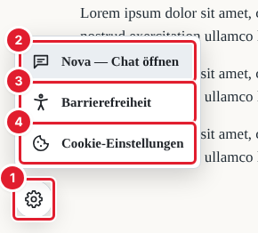
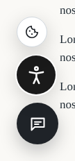
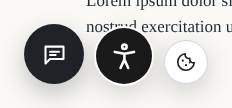

# Schaltflächen am Bildschirmrand

Manche Erweiterungen setzen eine kleine runde Schaltfläche in eine Ecke des
Bildschirms: den Knopf zum Wiederöffnen der Cookie-Einstellungen (NEO Cookie
Consent), die Schaltfläche des Barrierefreiheits-Panels (NEO Accessibility),
den Knopf des KI-Chats (NEO SuperAgent). Die Ecke ihrer Schaltfläche stellt
jede Erweiterung in ihren eigenen Einstellungen ein. Sitzen mehrere
Schaltflächen in derselben Ecke, ordnet Basic sie an, sodass sie nie
übereinanderliegen.

## Wo Sie die Ecken wählen

| Schaltfläche | Einstellung |
| --- | --- |
| Cookie-Einstellungen | **NEO Digital › Cookie-Hinweis › Einstellungen**, **Knopf zum Wiederöffnen**: unten links, unten rechts oder kein Knopf |
| Barrierefreiheits-Panel | Frontend-Modul *Barrierefreiheits-Panel*, **Position der Schaltfläche**: eine der vier Ecken oder keine Schaltfläche |
| KI-Chat | **NEO Digital › SuperAgent**, der Assistent, **Position**: unten rechts oder unten links |

Jede Kombination ist möglich: alle Schaltflächen in einer Ecke, zwei in einer
Ecke und eine in einer anderen, jede in ihrer eigenen Ecke.

## Mehrere Schaltflächen in einer Ecke

Wie die Schaltflächen einer Ecke erscheinen, stellen Sie im Seitenlayout ein
(**Layout › Themes › Seitenlayouts**, ein Seitenlayout bearbeiten), im
Abschnitt **Schaltflächen am Bildschirmrand**, Feld **Mehrere Schaltflächen
in einer Ecke**. Der Abschnitt erscheint, sobald eine Erweiterung installiert
ist, die ihn nutzt. Jedes Seitenlayout hat seine eigene Einstellung; mehrere
Websites in einer Installation können sich also unterscheiden.

| Auswahl | Was Besucher sehen |
| --- | --- |
| **Eine Einstellungs-Schaltfläche mit Menü** (Vorgabe) | Eine runde Schaltfläche mit Zahnrad namens **Einstellungen**. Sie öffnet ein Menü mit einem Eintrag je Schaltfläche; ein Eintrag öffnet das Panel seiner Erweiterung neben der Einstellungs-Schaltfläche. |
| **Übereinander gestapelt** | Die Schaltflächen in einer Spalte, die erste in der Ecke. |
| **Nebeneinander** | Die Schaltflächen in einer Reihe, die erste in der Ecke. |

Eine Ecke mit nur einer Schaltfläche zeigt diese, wie sie ist, gleich welche
Auswahl gilt. Die Reihenfolge steht fest: der KI-Chat am nächsten an der Ecke
(im Menü zuerst), dann das Barrierefreiheits-Panel, dann die
Cookie-Einstellungen.



1. Die **Einstellungs-Schaltfläche** in der gemeinsamen Ecke.
2. **KI-Chat** (die Beschriftung des Assistenten) öffnet das Chatfenster.
3. **Barrierefreiheit** öffnet das Barrierefreiheits-Panel; eine Zahl daneben
   sagt, wie viele seiner Einstellungen eingeschaltet sind.
4. **Cookie-Einstellungen** öffnet die Einstellungen des Cookie-Hinweises.

Übereinander gestapelt und nebeneinander:

 

Im Stapel öffnet sich das Fenster einer Schaltfläche neben ihr; Schaltflächen
über einem offenen Fenster treten zurück, bis es sich schließt.

## Tastatur und Screenreader

Die Einstellungs-Schaltfläche ist eine Menü-Schaltfläche: Enter, Leertaste
oder Pfeil nach unten öffnet das Menü beim ersten Eintrag, Pfeil nach oben
beim letzten; die Pfeiltasten wandern durch die Einträge (im Kreis), Pos1 und
Ende springen zum ersten und letzten; Esc schließt das Menü, der Fokus kehrt
zur Einstellungs-Schaltfläche zurück, Tab schließt es und geht weiter.
Schließt sich das Panel oder Fenster eines Eintrags, kehrt der Fokus zur
Einstellungs-Schaltfläche zurück. Die Schaltflächen sind mindestens
44 × 44 Pixel groß; das Menü öffnet sich ohne Bewegung, wenn das System des
Besuchers oder das Barrierefreiheits-Panel Bewegung ausschaltet.

## Gestaltung

Die Einstellungs-Schaltfläche und ihr Menü kommen im neutralen Grunddesign.
Die Website ändert es mit CSS-Variablen im eigenen Stylesheet, z. B.

```css
:root {
  --neo-dock-bg: #0b5cad;
  --neo-dock-text: #ffffff;
}
```

| Variable | Vorgabe | Was sie festlegt |
| --- | --- | --- |
| `--neo-dock-offset` | `16px` | Abstand der Einstellungs-Schaltfläche von den Bildschirmrändern |
| `--neo-dock-size` | `44px` | Größe der Einstellungs-Schaltfläche |
| `--neo-dock-icon-size` | `22px` | Größe des Zahnrads und der Symbole im Menü |
| `--neo-dock-gap` | `12px` | Abstand zwischen gestapelten Schaltflächen |
| `--neo-dock-menu-gap` | `12px` | Abstand zwischen Einstellungs-Schaltfläche und Menü |
| `--neo-dock-z` | `9000` | Stapelreihenfolge der Einstellungs-Schaltfläche (das Menü eins darüber) |
| `--neo-dock-bg`, `--neo-dock-text` | `#ffffff`, `#1f2328` | Farben der Einstellungs-Schaltfläche und des Menüs |
| `--neo-dock-line`, `--neo-dock-shadow` | `#d0d7de`, ein weicher Schatten | Rahmen und Schatten |
| `--neo-dock-hover` | `#eaeef2` | Eintrag unter der Maus oder mit dem Fokus |
| `--neo-dock-focus` | `#1f5fad` | Fokusrahmen |
| `--neo-dock-radius`, `--neo-dock-item-radius` | `8px`, `6px` | Ecken des Menüs und seiner Einträge |
| `--neo-dock-font`, `--neo-dock-font-size` | `inherit`, `15px` | Schrift des Menüs |
| `--neo-dock-badge-bg`, `--neo-dock-badge-text` | `#1f2328`, `#ffffff` | Zahl neben einem Eintrag |

Die Vorgaben erfüllen WCAG 2.1 AA; bei eigenen Farben den Kontrast prüfen
(Text 4,5:1, Schaltfläche und Rahmen 3:1). Der Name der Einstellungs-
Schaltfläche (**Einstellungen**) ist die Sprachvariable `MSC.neo_dock_settings`
(`contao/languages/<sprache>/default.php` der Website überschreibt sie).

## Fehlersuche

| Was Sie sehen | Warum | Was zu tun ist |
| --- | --- | --- |
| Das Feld fehlt im Seitenlayout | Keine installierte Erweiterung nutzt die Schaltflächen am Bildschirmrand, oder die Datenbank ist nicht aktualisiert | Die Datenbank aktualisieren (`contao:migrate`). |
| Zwei Schaltflächen liegen übereinander | Eine davon kommt aus einem überschriebenen Template ohne die `data-neo-dock`-Attribute (siehe Dokumentation ihrer Erweiterung), oder die Erweiterung ist älter | Die Attribute übernehmen, die Erweiterung aktualisieren. |
| Eine Schaltfläche fehlt, in ihrer Ecke sitzt ein Zahnrad | Mehrere Schaltflächen teilen sich die Ecke; das Seitenlayout steht auf *Eine Einstellungs-Schaltfläche mit Menü* | Gewollt; das Menü enthält die Schaltfläche. Eine andere Anordnung oder eine andere Ecke wählen. |
| Die Cookie-Schaltfläche fehlt vor der ersten Wahl im Menü | Der Cookie-Hinweis ist offen; sein Knopf zum Wiederöffnen erscheint erst, wenn der Besucher gewählt hat | Gewollt. |
