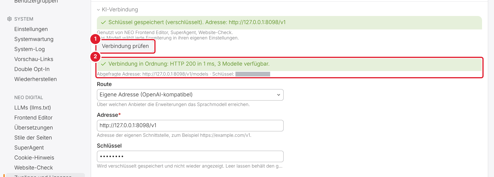

# Bedienung

Die Erweiterungen lesen ihre Schlüssel, die KI-Verbindung und die Zugänge der
Übersetzungsdienste aus *Zugänge und Lizenzen*. Ist die Seite eingerichtet
([Einrichtung](setup.md)), wird sie nur noch geöffnet, um eine Lizenz
einzutragen oder zu prüfen, neue Bedingungen zu bestätigen, einen Schlüssel zu
ändern oder eine Verbindung zu prüfen.

## Die Seite im Überblick

Backend → Menügruppe der Erweiterungen → **Zugänge und Lizenzen**.

Die Abschnitte kommen in dieser Reihenfolge:

1. **Lizenzen**: eine Zeile je bezahlter Erweiterung, immer offen.
2. **Bedingungen der Erweiterungen**: offen, solange etwas zu bestätigen ist.
3. **KI-Verbindung**, gemeinsam für die Erweiterungen, die ein Sprachmodell
   nutzen.
4. **Azure Translator** und **DeepL**, gemeinsam für die Erweiterungen, die
   Texte übersetzen.
5. Die Abschnitte der Erweiterungen, z. B. der Schlüssel eines Suchdienstes.

Ein Abschnitt ohne offene Aufgabe ist zu Beginn zugeklappt, einer, in dem etwas
fehlt, offen. Ein Klick auf den Titel öffnet oder schließt einen Abschnitt;
Contao merkt sich das für den Rest der Sitzung. Die Leiste über dem Formular
springt zu einem Abschnitt. Ein Link aus der Warnung einer Erweiterung öffnet
ihren Abschnitt.

### Statuszeilen

Jeder Abschnitt beginnt mit einer Statuszeile; darunter nennt eine Zeile die
Erweiterungen, die den Abschnitt nutzen („Genutzt von …“).

| Zeile | Bedeutung |
| --- | --- |
| Grün, mit Haken | Gespeichert, einsatzbereit. Bei der KI-Verbindung und den Übersetzungsdiensten steht auch die genutzte Adresse dabei, z. B. „Schlüssel gespeichert (verschlüsselt). Adresse: …“. |
| Blau, mit Hinweiszeichen | Nichts gespeichert, und nicht für jede Funktion nötig, z. B. „Nicht hinterlegt. Wird nur für einzelne Funktionen gebraucht.“ |
| Rot | Etwas fehlt, das die Erweiterungen brauchen, z. B. „Noch kein Schlüssel gespeichert.“ |

Alle Texte und was zu tun ist, stehen in der [Fehlersuche](troubleshooting.md).

## Schlüssel

- Ein gespeicherter Schlüssel erscheint als acht Punkte, nie wieder im Klartext.
- Um einen Schlüssel zu behalten, das Feld lassen, wie es ist, oder leeren. Ein
  leeres Feld löscht nie einen gespeicherten Schlüssel.
- Um einen Schlüssel zu ändern, den neuen in das Feld tippen und auf
  **Speichern** klicken. Er wird verschlüsselt gespeichert, genau so, wie er
  eingegeben wurde.
- Ein gespeicherter Schlüssel lässt sich ersetzen, auf dieser Seite aber nicht
  entfernen.

Nachdem das App-Secret der Installation (`APP_SECRET`) geändert wurde, lassen
sich gespeicherte Schlüssel nicht mehr entschlüsseln; dann alle neu eintragen.

## Verbindung prüfen

**Verbindung prüfen** in den Abschnitten **KI-Verbindung**, **Azure
Translator** und **DeepL** ruft den Dienst vom Server der Website aus mit den
gespeicherten Werten auf. Die Seite wird dabei nicht verlassen: Das Ergebnis
erscheint unter der Schaltfläche, und was Sie im Formular getippt haben,
bleibt stehen. Noch nicht Gespeichertes wird nicht geprüft; zuerst speichern.
Fehlt, was die Prüfung braucht (etwa der Schlüssel), ist die Schaltfläche
gesperrt, und daneben steht „Kann geprüft werden, sobald der Zugang
gespeichert ist.“

- Während der Prüfung steht auf der Schaltfläche „Wird geprüft …“, und sie
  lässt sich nicht klicken.
- Die Ergebniszeile:
  - KI-Verbindung: „Verbindung in Ordnung: HTTP 200 in … ms, … Modelle
    verfügbar.“ Die Prüfung fragt die Route nach ihrer Liste der Modelle.
  - Azure Translator: „Verbindung in Ordnung: HTTP 200 in … ms.“ Die Prüfung
    übersetzt ein Wort.
  - DeepL: „Verbindung in Ordnung: HTTP 200 in … ms. In diesem
    Abrechnungszeitraum verbraucht: … von … Zeichen.“ Die Prüfung übersetzt
    nichts.
  - Antwortet der Dienst mit einem Fehler, nennt die Zeile den HTTP-Status und
    die Dauer, darunter steht der Anfang der Antwort.
- Unter dem Ergebnis: was geprüft wurde, z. B. „Abgefragte Adresse: … ·
  Schlüssel: …“. Vom Schlüssel erscheinen nur Länge, erste vier und letzte
  zwei Zeichen; in jeder Meldung ist er durch `***` ersetzt.

Screenreader lesen das Ergebnis vor, sobald es erscheint.

## Lizenzen

Der Abschnitt **Lizenzen** hat eine Zeile je bezahlter Erweiterung: links das
Feld ***Erweiterung*: Lizenzschlüssel**, rechts der Stand, der Zeitpunkt der
letzten Prüfung („Zuletzt geprüft: …“) und die Schaltfläche **Jetzt prüfen**.

Die Statuszeile endet mit einem Link auf die Seite der Erweiterung im Store:
**Lizenzschlüssel im Store kaufen** ohne Lizenz, **Höhere Stufe oder
Verlängerung im Store** mit Lizenz. Er öffnet sich in einem neuen Tab, damit
die Seite behält, was Sie eingetragen haben.

Die Statuszeile sagt, was die Lizenz abdeckt:

- „Lizenz Plus gültig bis … für example.com.“ – die Stufe (Basis, Plus oder
  Pro), das Ende des bezahlten Zeitraums und die lizenzierten Domains.
- „Lizenz Plus unbegrenzt gültig für example.com.“ – eine Lizenz ohne
  Enddatum.
- „Lizenz … gekündigt, gültig bis … für …“ – die Lizenz endet an diesem Tag.
- „Lizenz … am … abgelaufen. Ohne Verlängerung gilt sie noch bis …“ – die
  Nachfrist nach dem Ende der Lizenz.
- „Ohne Lizenz.“ – die Erweiterung läuft als Gratisfassung. Was jede Stufe
  umfasst, zeigt ihre Seite im Store (Link in derselben Zeile).

Weitere Zustände und Meldungen stehen in der
[Fehlersuche](troubleshooting.md#lizenzen).

### Jetzt prüfen

**Jetzt prüfen** fragt den Lizenzdienst sofort, ob die Lizenz noch gilt. Die
Seite wird nicht verlassen und springt nicht: Während der Prüfung steht auf der
Schaltfläche „Wird geprüft …“, und sie lässt sich nicht klicken; danach zeigen
Statuszeile und Zeitpunkt der letzten Prüfung den neuen Stand. Ist der
Lizenzdienst nicht erreichbar oder kennt er den Schlüssel nicht, steht das
direkt in der Zeile.

Die Schaltfläche erscheint, sobald ein Schlüssel gespeichert ist.

### Was mit einer Lizenz geschieht

- **Aktivieren:** den Schlüssel eintragen und speichern. Er wird sofort beim
  Lizenzdienst aktiviert.
- **Prüfen:** Der Contao-Cron prüft die Lizenz einmal am Tag neu, **Jetzt
  prüfen** sofort. Den signierten Nachweis des Lizenzdienstes prüft die Website
  bei jedem Aufruf selbst; der Dienst wird dafür nicht gefragt.
- **Wenn der Lizenzdienst nicht erreichbar ist:** Der letzte Nachweis gilt
  weiter, bis seine Nachfrist endet. Die Prüfung wird innerhalb einer Stunde
  automatisch wiederholt.
- **Schlüssel ändern:** Das Feld zeigt den gespeicherten Schlüssel gekürzt auf
  Anfang und die letzten vier Zeichen. Speichern mit dem unveränderten
  gekürzten Schlüssel behält die Lizenz; zum Ändern den ganzen Schlüssel
  ersetzen und speichern.
- **Entfernen:** das Feld leeren und speichern. Die Lizenz wird von der Website
  entfernt, und der Lizenzdienst erfährt es.

### Domains und Installationen

Eine Lizenz gilt für die in ihr eingetragenen Domains, Subdomains
eingeschlossen; andere Domains zählen nicht. Zusätzlich zählt der Lizenzdienst
die Contao-Installationen, in denen ein Schlüssel läuft, damit ein Schlüssel
nicht in mehr Installationen verwendet wird als bezahlt.

- Normale Lizenz: eine Installation mit einer eingetragenen Domain.
- Zusätzliche Domains je Installation (Add-on): Wer in einer
  Contao-Installation mehrere Websites mit verschiedenen Domains betreibt,
  bucht bis zu zwei weitere Domains und trägt sie ein; sie gelten in dieser
  einen Installation.
- Agenturlizenz: eine Zahl an Installationen mit einem Schlüssel; die Agentur
  trägt ihre Domains im Kundenbereich ein, bis „Installationen × Domains je
  Installation“. Auch hier zählen nur eingetragene Domains.

- **Installation:** Jede Installation hat eine eigene Kennung. Basic erzeugt sie
  einmal, wenn eine Lizenz zum ersten Mal aktiviert oder geprüft wird, und
  behält sie, auch nach Updates. Sie geht bei jeder Prüfung mit. Eine Kopie der
  Datenbank (z. B. Staging) hat dieselbe Kennung und zählt als dieselbe
  Installation.
- **Domains:** Die Installation meldet den **Domainnamen** jedes Startpunkts.
  Ein Startpunkt ohne Domainnamen steht für die Adresse, von der aus geprüft
  wird (das Backend, oder die Website, wenn der Web-Cron läuft). Höchstens 20.
- **In der Zeile der Lizenz** steht je Domain „gültig“ oder, warum die Lizenz
  sie nicht abdeckt:
  - die Domain ist in der Lizenz nicht eingetragen;
  - die Lizenz ist schon in allen erlaubten Installationen aktiv;
  - diese Installation nutzt mehr Domains, als die Lizenz je Installation
    erlaubt.
- Darunter „Installationen: m von n belegt“ und „bis zu n Domains je
  Installation“, wenn der Lizenzdienst das mitteilt.
- **Sind alle Installationen belegt**, steht über den Domains eine rote
  Warnung: Die Lizenz kann hier nicht aktiviert werden. Eine Lizenz gilt
  standardmäßig in einer Installation; mehr Installationen stellt der
  Hersteller ein, die Warnung verlinkt seine Website.

Auf einer nicht abgedeckten Domain läuft die Erweiterung in der Gratisfassung;
die übrigen Domains betrifft das nicht. Was zu tun ist, sagt die Zeile, siehe
auch [Fehlerbehebung](troubleshooting.md#lizenzen).

## Bedingungen der Erweiterungen

Eine Erweiterung kann ihre Bedingungen in Passagen teilen: eine für alle Stufen
und je eine pro Stufe. Der Abschnitt **Bedingungen der Erweiterungen** zeigt je
Erweiterung die Passagen, die für ihre lizenzierte Stufe gelten.

- Die Überschrift nennt die Erweiterung und ihre Stufe („… · Stufe Plus“) oder
  „… · ohne Lizenz“.
- Jede Passage zeigt ihren Titel, ihre Fassung („Fassung 1“) und **Text
  anzeigen**. Eine noch zu bestätigende Passage ist mit **neu** markiert, oder
  mit **geändert**, wenn sie in einer früheren Fassung bestätigt wurde.
- Die Texte erscheinen in der Sprache des Backends. In einer anderen
  Backend-Sprache als Deutsch steht neben der Übersetzung der Hinweis, dass die
  deutsche Fassung verbindlich ist, und **Deutsche Fassung anzeigen** öffnet
  sie.

Bestätigen:

1. Die Passagen lesen (**Text anzeigen**).
2. **Ich habe die Bedingungen gelesen und akzeptiere sie.** anhaken.
3. Auf **Bestätigen** klicken.

**Bestätigen** schickt das ganze Formular ab, wie **Speichern**: Änderungen in
anderen Feldern der Seite werden dabei mitgespeichert. Die Statuszeile sagt
danach „Bestätigt von *Benutzer* am *Datum*.“ Die Seite hält fest, wer welche
Fassung welcher Passage wann bestätigt hat und in welcher Sprache der Text
angezeigt wurde.

Eine höhere Stufe oder eine geänderte Passage verlangt eine neue Bestätigung.
Was bis dahin gesperrt bleibt, entscheidet die Erweiterung.

## Warnungen in den Erweiterungen

Fehlt ein Schlüssel, den eine Erweiterung braucht, sagt sie es oben auf ihrer
eigenen Backend-Seite, mit der Folge für die Website. Benutzer, die *Zugänge
und Lizenzen* öffnen dürfen, bekommen dazu den Link **Jetzt unter „Zugänge und
Lizenzen“ hinterlegen**, der direkt zum Abschnitt führt und ihn öffnet. Bei
noch zu bestätigenden Bedingungen heißt der Link **Jetzt bestätigen**.

## Ein Modell oder einen Übersetzungsdienst in einer Erweiterung wählen

Das Modell der KI-Verbindung und, wo eine Erweiterung Texte übersetzt, der
Übersetzungsdienst werden in den Einstellungen jeder Erweiterung gewählt. Ein
Feld für das Modell bietet die Modelle der Route als durchsuchbare Auswahl an;
die Liste wird eine Stunde zwischengespeichert, ein neu freigegebenes Modell der
Route kann also bis zu einer Stunde brauchen, bis es erscheint. Ohne
gespeicherten Schlüssel bleibt das Feld ein Textfeld.
