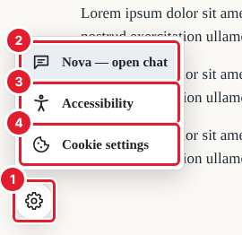
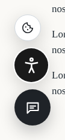
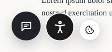

# Buttons at the edge of the screen

Some extensions put a small round button into a corner of the screen: the
button to reopen the cookie settings (NEO Cookie Consent), the button of the
accessibility panel (NEO Accessibility), the button of the AI chat (NEO
SuperAgent). Each extension sets the corner of its button in its own
settings. When several buttons sit in the same corner, Basic arranges them,
so they never lie on top of each other.

## Where you choose the corners

| Button | Setting |
| --- | --- |
| Cookie settings | **NEO Digital › Cookie consent › Settings**, **Button to reopen**: bottom left, bottom right or no button |
| Accessibility panel | front-end module *Accessibility panel*, **Position of the button**: one of the four corners or no button |
| AI chat | **NEO Digital › SuperAgent**, the assistant, **Position**: bottom right or bottom left |

Every combination is possible: all buttons in one corner, two in one corner
and one in another, each in its own corner.

## Several buttons in one corner

How the buttons of one corner appear is set in the page layout
(**Layout › Themes › Page layouts**, edit a page layout), in the section
**Buttons at the edge of the screen**, field **Several buttons in one
corner**. The section is there as soon as an extension that uses it is
installed. Each page layout has its own setting, so several websites in one
installation can differ.

| Choice | What visitors see |
| --- | --- |
| **One settings button with a menu** (default) | One round button with a cogwheel, called **Settings**. It opens a menu with one entry per button; an entry opens the panel of its extension next to the settings button. |
| **Stacked one above the other** | The buttons in a column, the first one in the corner. |
| **Side by side** | The buttons in a row, the first one in the corner. |

A corner with a single button shows that button as it is, whatever the
choice. The order is fixed: the AI chat nearest the corner (first in the
menu), then the accessibility panel, then the cookie settings.



1. The **settings button** in the shared corner.
2. **AI chat** (the label of the assistant) opens the chat window.
3. **Accessibility** opens the accessibility panel; a number next to it says
   how many of its settings are on.
4. **Cookie settings** opens the settings of the cookie banner.

Stacked one above the other and side by side:

 

In a stack, the window of a button opens next to its button; buttons above an
open window step back until it closes.

## Keyboard and screen readers

The settings button is a menu button: Enter, Space or Arrow down opens the
menu on its first entry, Arrow up on its last; the arrow keys move through the
entries (round), Home and End go to the first and the last; Esc closes the
menu and the focus goes back to the settings button, Tab closes it and moves
on. When the panel or window of an entry closes, the focus goes back to the
settings button. The buttons are at least 44 × 44 pixels; the menu opens
without movement when the visitor's system or the accessibility panel
switches movement off.

## Design

The settings button and its menu come in a neutral design. The website
changes it with CSS variables in its own stylesheet, e.g.

```css
:root {
  --neo-dock-bg: #0b5cad;
  --neo-dock-text: #ffffff;
}
```

| Variable | Default | What it sets |
| --- | --- | --- |
| `--neo-dock-offset` | `16px` | Distance of the settings button from the edges of the screen |
| `--neo-dock-size` | `44px` | Size of the settings button |
| `--neo-dock-icon-size` | `22px` | Size of the cogwheel and of the icons in the menu |
| `--neo-dock-gap` | `12px` | Gap between stacked buttons |
| `--neo-dock-menu-gap` | `12px` | Gap between the settings button and its menu |
| `--neo-dock-z` | `9000` | Stacking order of the settings button (the menu one above) |
| `--neo-dock-bg`, `--neo-dock-text` | `#ffffff`, `#1f2328` | Colours of the settings button and the menu |
| `--neo-dock-line`, `--neo-dock-shadow` | `#d0d7de`, a soft shadow | Border and shadow |
| `--neo-dock-hover` | `#eaeef2` | Entry under the mouse or with the focus |
| `--neo-dock-focus` | `#1f5fad` | Focus outline |
| `--neo-dock-radius`, `--neo-dock-item-radius` | `8px`, `6px` | Corners of the menu and of its entries |
| `--neo-dock-font`, `--neo-dock-font-size` | `inherit`, `15px` | Font of the menu |
| `--neo-dock-badge-bg`, `--neo-dock-badge-text` | `#1f2328`, `#ffffff` | Number next to an entry |

The defaults meet WCAG 2.1 AA; check the contrast of own colours (text
4.5:1, button and border 3:1). The name of the settings button (**Settings**)
is the language label `MSC.neo_dock_settings` (`contao/languages/<language>/default.php`
of the website overrides it).

## Troubleshooting

| What you see | Why | What to do |
| --- | --- | --- |
| The field is missing in the page layout | No installed extension uses the buttons at the edge of the screen, or the database is not updated | Update the database (`contao:migrate`). |
| Two buttons lie on top of each other | One of them comes from an overridden template without the `data-neo-dock` attributes (see the documentation of its extension), or the extension is older | Take over the attributes, update the extension. |
| A button is missing, a cogwheel sits in its corner | Several buttons share the corner; the page layout is on *One settings button with a menu* | Intended; the menu holds the button. Choose another arrangement or another corner. |
| The cookie button is missing in the menu before the first choice | The cookie banner is open; its button to reopen is shown only once the visitor has chosen | Intended. |
