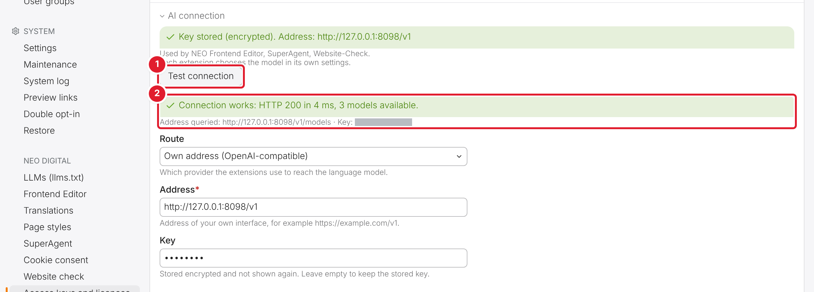

# Usage

The extensions read their keys, the AI connection and the accesses of the
translation services from *Access keys and licences*. Once the page is set up
([Setup](setup.md)), it is opened again only to enter or check a licence, to
confirm new terms, to change a key or to test a connection.

## The page at a glance

Back end → menu group of the extensions → **Access keys and licences**.

The sections come in this order:

1. **Licences**: one row per paid extension, always open.
2. **Terms of the extensions**: open while something is still to be confirmed.
3. **AI connection**, shared by the extensions that use a language model.
4. **Azure Translator** and **DeepL**, shared by the extensions that translate
   texts.
5. The sections of the extensions, e.g. the key of a search service.

A section with nothing left to do starts collapsed, one where something is
missing starts open. Click the title of a section to open or close it; Contao
remembers that for the rest of the session. The bar above the form jumps to a
section. A link from an extension's warning opens its section.

### Status lines

Each section starts with a status line; below it, one line names the
extensions that use the section ("Used by …").

| Line | Meaning |
| --- | --- |
| Green, with a tick | Stored, ready to use. For the AI connection and the translation services it also names the address in use, e.g. "Key stored (encrypted). Address: …". |
| Blue, with an information sign | Nothing stored, and not needed for every function, e.g. "Not stored. Only needed for some functions." |
| Red | Something the extensions need is missing, e.g. "No key stored yet." |

All texts and what to do about them are in [Troubleshooting](troubleshooting.md).

## Keys

- A stored key is shown as eight dots, never again in plain text.
- To keep a key, leave its field as it is or empty. An empty field never
  deletes a stored key.
- To change a key, type the new one into the field and click **Save**. It is
  stored encrypted, exactly as typed.
- A stored key can be replaced, but not removed on this page.

After the Contao app secret (`APP_SECRET`) of the installation has been
changed, stored keys can no longer be decrypted; enter them again.

## Testing a connection

**Test connection** in the sections **AI connection**, **Azure Translator** and
**DeepL** calls the service from the website's server with the saved values.
The page is not left: the result appears below the button, and what you typed
in the form stays there. Entries not saved yet are not tested; save first.
When something the test needs is missing (e.g. the key), the button is
disabled and says next to it "Can be tested once the access is saved."

- While the test runs, the button says "Testing …" and cannot be clicked.
- The result line:
  - AI connection: "Connection works: HTTP 200 in … ms, … models available."
    The test asks the route for its list of models.
  - Azure Translator: "Connection OK: HTTP 200 in … ms." The test translates
    one word.
  - DeepL: "Connection OK: HTTP 200 in … ms. Used in this billing period: …
    of … characters." The test translates nothing.
  - If the service answers with an error, the line names the HTTP status and
    the duration, and below it the beginning of the answer is shown.
- Below the result: what was tested, e.g. "Address queried: … · Key: …". The
  key appears only as its length, its first four and its last two characters;
  in every message it is replaced by `***`.

Screen readers announce the result when it appears.

## Licences

The section **Licences** has one row per paid extension: on the left the field
***Extension*: Licence key**, on the right the status, the time of the last
check ("Last checked: …") and the button **Check now**.

The status line ends with a link to the page of the extension in the store:
**Buy a licence key in the store** without a licence, **Higher edition or
renewal in the store** with one. It opens in a new tab, so the page keeps what
you typed.

The status line says what the licence covers:

- "Licence Plus valid until … for example.com." – the edition (Basic, Plus or
  Pro), the end of the paid period and the licensed domains.
- "Licence Plus, unlimited, for example.com." – a licence without an end date.
- "Licence … cancelled, valid until … for …" – the licence ends at that date.
- "Licence … expired on …. Without renewal it remains valid until …" – the
  grace period after the end of the licence.
- "No licence." – the extension runs as its free edition. What each edition
  includes is shown on its page in the store (link in the same line).

Further states and messages are listed in
[Troubleshooting](troubleshooting.md#licences).

### Check now

**Check now** asks the licence service at once whether the licence is still
valid. The page is not left and does not move: while the check runs, the
button says "Checking …" and cannot be clicked; then the status line and the
time of the last check show the new state. If the licence service cannot be
reached or does not know the key, the row says so in place.

The button appears as soon as a key is stored.

### What happens with a licence

- **Activating:** enter the key and save. The key is activated at the licence
  service at once.
- **Checking:** the licence is checked again once a day by the Contao cron,
  and at once with **Check now**. The signed confirmation of the licence
  service is checked locally on every request; the service is not asked for
  that.
- **When the licence service cannot be reached:** the last confirmation stays
  valid until its grace period ends. The check is repeated automatically
  within an hour.
- **Changing the key:** the field shows the stored key shortened to its start
  and its last four characters. Saving with the shortened key unchanged keeps
  the licence; to change it, replace the whole key and save.
- **Removing:** empty the field and save. The licence is removed from the
  website and the licence service is told.

### Domains and installations

A licence covers the domains entered in it, subdomains included; no other
domain counts. In addition, the licence service counts the Contao
installations a key runs in, so that a key is not used in more installations
than paid for.

- A normal licence: one installation with one entered domain.
- Additional domains per installation (add-on): whoever runs several websites
  with different domains in one Contao installation books up to two more
  domains and enters them; they apply in that one installation.
- Agency licence: a number of installations with one key; the agency enters
  its domains in the customer area, up to "installations × domains per
  installation". Here, too, only entered domains count.

- **Installation:** each installation has its own identifier. Basic creates it
  once, when a licence is first activated or checked, and keeps it, also after
  updates. It is sent with every check. A copy of the database (e.g. staging)
  has the same identifier and counts as the same installation.
- **Domains:** the installation reports the **Domain name** of each root page.
  A root page without a domain name stands for the address the check is made
  from (the back end, or the website when the web cron runs). At most 20.
- **In the row of the licence**, one line per domain: "valid", or why the
  licence does not cover it:
  - the domain is not entered in the licence;
  - the licence is already active in all installations it allows;
  - this installation uses more domains than the licence allows per
    installation.
- Below it: "Installations: m of n in use" and "up to n domains per
  installation", when the licence service says so.
- **When all installations are in use**, a red warning stands above the
  domains: the licence cannot be activated here. A licence covers one
  installation by default; more installations are set by the manufacturer,
  the warning links to the manufacturer's website.

A domain that is not covered keeps the free edition of the extension on that
domain; the other domains are not affected. What to do is said in the line, see
also [Troubleshooting](troubleshooting.md#licences).

## Terms of the extensions

An extension can split its terms into passages: one for all editions and one
per edition. The section **Terms of the extensions** shows, per extension, the
passages that apply to its licensed edition.

- The heading names the extension and its edition ("… · edition Plus"), or
  "… · without licence".
- Each passage shows its title, its version ("version 1") and **show text**. A
  passage still to be confirmed is marked **new**, or **changed** when it was
  confirmed in an earlier version.
- The texts are shown in the language of the back end. Next to a translation,
  a note says that the German version is binding, and **Show the German
  version** opens it.

To confirm:

1. Read the passages (**show text**).
2. Tick **I have read the terms and accept them.**
3. Click **Confirm**.

**Confirm** sends the whole form, like **Save**: changes in other fields of
the page are saved at the same time. The status line then says "Confirmed by
*user* on *date*." The page records who confirmed which version of which
passage, when, and in which language the text was shown.

A higher edition or a changed passage asks for a new confirmation. Until then,
the extension decides what stays locked.

## Warnings in the extensions

When a key an extension needs is missing, the extension says so at the top of
its own back-end page, with what this means for the website. Users who may
open *Access keys and licences* also get the link **Enter it now under "Access
keys and licences"**, which leads directly to the section and opens it. For
terms still to be confirmed, the link is **Confirm now**.

## Choosing a model or a translation service in an extension

The model of the AI connection and, where an extension translates texts, the
translation service are chosen in the settings of each extension. A model
field offers the models of the route as a searchable list; the list is kept
for an hour, so a model newly approved at the route can take up to an hour to
appear. Without a stored key the field stays a text field.
